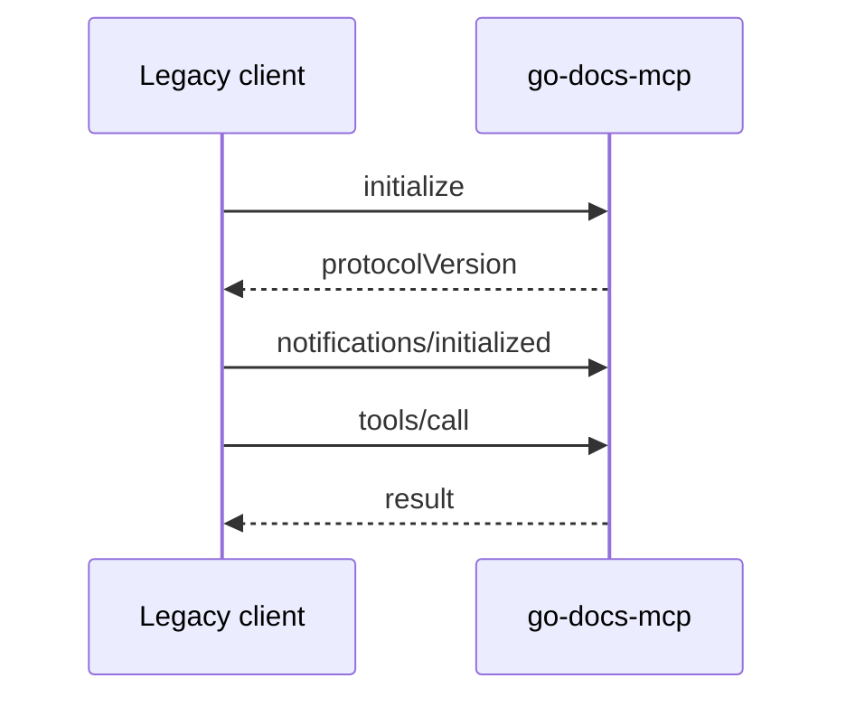
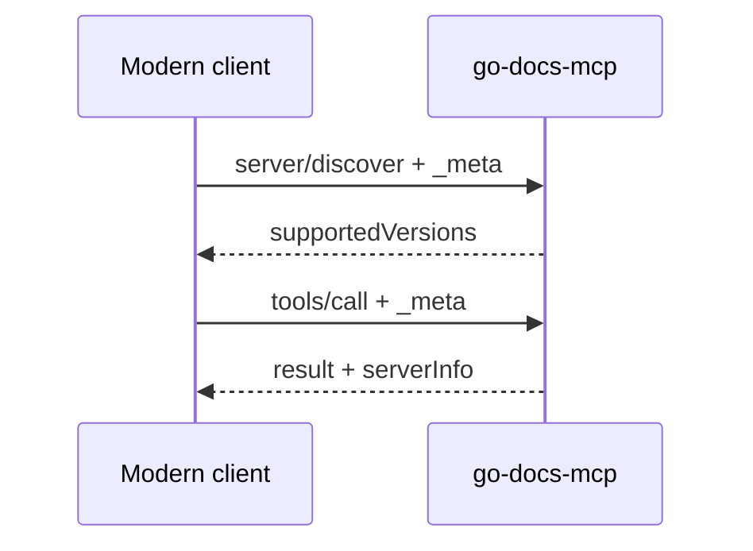

# 🔀 MCP 2026-07-28: both protocol eras

The MCP revision `2026-07-28` removed the `initialize` handshake and
sessions. A **legacy-era** client opens with `initialize`. A **modern-era**
client sends no handshake: every request carries
`io.modelcontextprotocol/protocolVersion` and
`io.modelcontextprotocol/clientCapabilities` in `params._meta`.

go-docs-mcp serves both eras from the same binary, with nothing to
configure. The behaviour comes from
[mark3labs/mcp-go](https://github.com/mark3labs/mcp-go) v1.5.0; the server
code has no branch for either era. The 13 tool definitions (description,
input schema, output schema, annotations) are identical in both, and the
progress notifications of `ocr_document` arrive in both.





---

## 📡 What the binary answers over stdio

| Request | Answer |
|---------|--------|
| `initialize` offering `2024-11-05`, `2025-03-26`, `2025-06-18` or `2025-11-25` | the same revision |
| `initialize` offering an unknown revision, or `2026-07-28` | `2025-11-25` |
| `server/discover` with the envelope | `resultType: "complete"`, `supportedVersions`: `2026-07-28`, `2025-11-25`, `2025-06-18`, `2025-03-26`, `2024-11-05` |
| `tools/list`, `tools/call`, `resources/list`, `resources/read` with the envelope and no handshake | served; every result carries `_meta["io.modelcontextprotocol/serverInfo"]` |
| envelope without `clientCapabilities` | error `-32602`, the message names the missing key |
| envelope with an unknown revision | error `-32022`, `data.supported` lists the five revisions |

---

## 🧪 How it is tested

Both files start the real binary over stdio, as a client would.

- [`contract_test.go`](../contract_test.go) drives it with the mcp-go
  client in three modes: `TestLegacyHandshakeClient` (expects `2025-11-25`),
  `TestModernPinnedClient` and `TestAutoNegotiatingClient` (both expect
  `2026-07-28`). Each mode checks the server name and version, the 13 tool
  names, the 8 tools with an output schema, a `list_documents` call with its
  structured content, a `convert_to_markdown` call, a path traversal that
  must come back as a tool error, and `resources/list` and `resources/read`.
- [`raw_wire_test.go`](../raw_wire_test.go) writes each JSON-RPC line by
  hand and imports only the standard library: `TestRawWireLegacyHandshake`
  (the four legacy revisions), `TestRawWireInitializeFallsBackToLatestLegacy`,
  `TestRawWireDiscover`, `TestRawWireModernWithoutHandshake`,
  `TestRawWireModernMissingClientCapabilities`,
  `TestRawWireModernUnknownVersion`,
  `TestRawWireToolDefinitionsMatchAcrossEras` and
  `TestRawWireOCRProgressInBothEras`. The last one skips when `tesseract`,
  `pdftoppm` or `pdfinfo` is not in `PATH`.

The contract tests use the same library on both ends, so a change in
mcp-go that moved client and server at once would keep them green. The
raw-wire tests have no SDK on the client side, which makes them the arbiter
for any mcp-go upgrade: they must pass unchanged, or the upgrade does not
merge.

CI runs both files on every push to `main` and every pull request, on
Ubuntu and macOS. The weekly job `next-sdk-radar` (Monday 06:00 UTC, or
started by hand) runs the era tests against the newest mcp-go and never
blocks anything. Its first run, on 2026-11-10, passed; the newest mcp-go
that day was v1.5.0, the version `go.mod` already pins.

To run the era tests locally:

```bash
go test . -run 'TestRawWire|TestLegacyHandshakeClient|TestModernPinnedClient|TestAutoNegotiatingClient' -count=1
```

---

## 🧭 Independent clients

Run once by hand on 2026-11-10. This check is not in CI and its script is
not in the repository.

| Client | Result |
|--------|--------|
| Python `mcp` SDK 2.3.0, mode legacy | negotiated `2025-11-25`; 13 tools, `list_documents` and `resources/list` correct |
| Python `mcp` SDK 2.3.0, mode `2026-07-28` | negotiated `2026-07-28`; same checks correct |
| Python `mcp` SDK 2.3.0, mode auto | negotiated `2026-07-28`; same checks correct |
| Claude Code 2.1.321 | called `list_documents` correctly; spoke `2026-07-28` |

A recording of the Claude Code frames shows no `initialize`. It sent
`server/discover`, `subscriptions/listen`, `resources/list`, `tools/list`
and `tools/call`. Claude Code already uses the modern era, so the legacy
era was exercised by the Python client and the test suites. Claude Desktop
was not tested in this round.

---

## ⚠️ Known limit

On stdio, mcp-go writes notifications from a separate goroutine, so the
last progress notification of `ocr_document` can reach the client after
the response to the call, in either era. The tests check that both
notifications arrive and their order between themselves, not their order
against the response.
